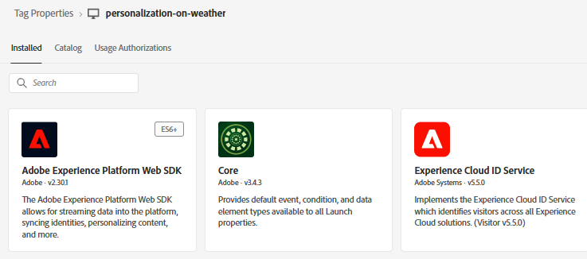
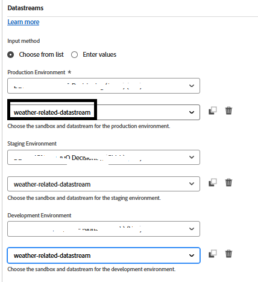
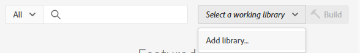

# Creación de etiquetas de Adobe Experience Platform

Las etiquetas de Adobe Experience Platform (anteriormente Adobe Launch) ayudan a administrar e implementar* tecnologías de marketing y análisis en su sitio web sin necesidad de cambiar el código del sitio.

En este [vídeo se describe el proceso de creación de Adobe Experience Tags](https://experienceleague.adobe.com/en/playlists/experience-platform-get-started-with-tags)

* Iniciar sesión en la recopilación de datos
* Haga clic en _&#x200B;**Etiquetas -> Nueva propiedad**
* Cree una Adobe Experience Platform Tag llamada _&#x200B;**personalización según el tiempo**&#x200B;_.
* Añada las siguientes extensiones a la etiqueta

* Agregue un elemento de datos llamado &quot;ECID&quot; como se muestra a continuación. Este elemento de datos se utiliza más adelante en los informes

* Asegúrese de configurar Adobe Experience Platform Web SDK para que utilice el entorno correcto y la **secuencia de datos relacionada con el tiempo** creada en el paso anterior.

## Creación e implementación de etiquetas de AEP

Cree una nueva biblioteca y añádale todos los recursos modificados, como se muestra en las capturas de pantalla siguientes.

**Agregar biblioteca**

**Crear una biblioteca**

En la pantalla Crear biblioteca, especifique el nombre de la biblioteca y el entorno.

Añadir todos los recursos modificados a esta biblioteca

A continuación, haga clic en el botón Guardar y crear en desarrollo para crear la biblioteca

## Incluir etiquetas de AEP en la página de HTML

Cuando publica una propiedad de etiquetas de AEP, Adobe le proporciona una etiqueta de script que debe colocar dentro de su HTML ` <head>` o en la parte inferior de las etiquetas ` <body>`.

1. Vaya a la propiedad Etiquetas (personalización según el tiempo).
2. Haga clic en Entornos y en el icono de instalación del entorno que desee (por ejemplo, Desarrollo, Ensayo, Producción).
3. Anote el código incrustado. Se necesita en una etapa posterior de este tutorial.
