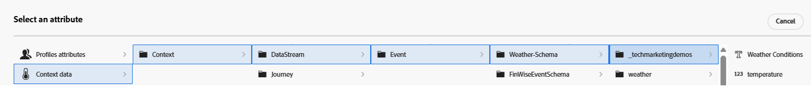

# Crear fórmula de clasificación

Durante la toma de decisiones de oferta se utiliza una fórmula de clasificación en Adobe Journey Optimizer, específicamente dentro de una estrategia de selección para determinar el orden de prioridad de las ofertas aptas. La fórmula de clasificación entra en juego después del filtrado de elegibilidad, cuando varias ofertas cumplen los requisitos para un perfil determinado, pero solo la principal (o pocas) debe presentarse en función de la lógica empresarial o el contexto del perfil.

* Iniciar sesión en Journey Optimizer

* Vaya a _**Decisión ->Configuración de estrategia ->Fórmulas de clasificación ->Crear fórmula**_

Asigne un nombre a la fórmula _**Tiempo - Relacionado - Ofertas**_

Un criterio en una fórmula de clasificación hace referencia a una regla condicional utilizada para asignar una puntuación a una oferta. Estos criterios comparan atributos de la oferta y el contexto para determinar la relevancia de una oferta para un individuo específico.

Los siguientes tres criterios se definen para filtrar ofertas y luego asignar una puntuación de clasificación a la oferta elegible. Los criterios se definen con el generador de criterios. Los datos de contexto también se pueden utilizar para definir los criterios, como se muestra en la captura de pantalla siguiente

Los 3 criterios utilizados incluyen un atributo de oferta (etiqueta) y un atributo de datos de contexto (temperatura) al definir los criterios.

## Criterios uno

| **Etiqueta de oferta** | **Condición de datos de contexto** | **Lógica de puntuación** |
|------------------|---------------------|-------------------------------------|
| **activo** | temperatura > 80 | score=Temperatura |

## Criterios dos

| **Etiqueta del tiempo** | **Condición de datos de contexto** | **Lógica de puntuación** |
|------------------|---------------------------|----------------------------------------------|
| **primavera** | temperatura > 65 y &lt; 80 | score=temperatura × 4 |

## Criterios tres

| **Etiqueta del tiempo** | **Condición de datos de contexto** | **Lógica de puntuación** |
|------------------|---------------------------|----------------------------------------------|
| **frío** | temperatura &lt; 65 | score =temperatura |
