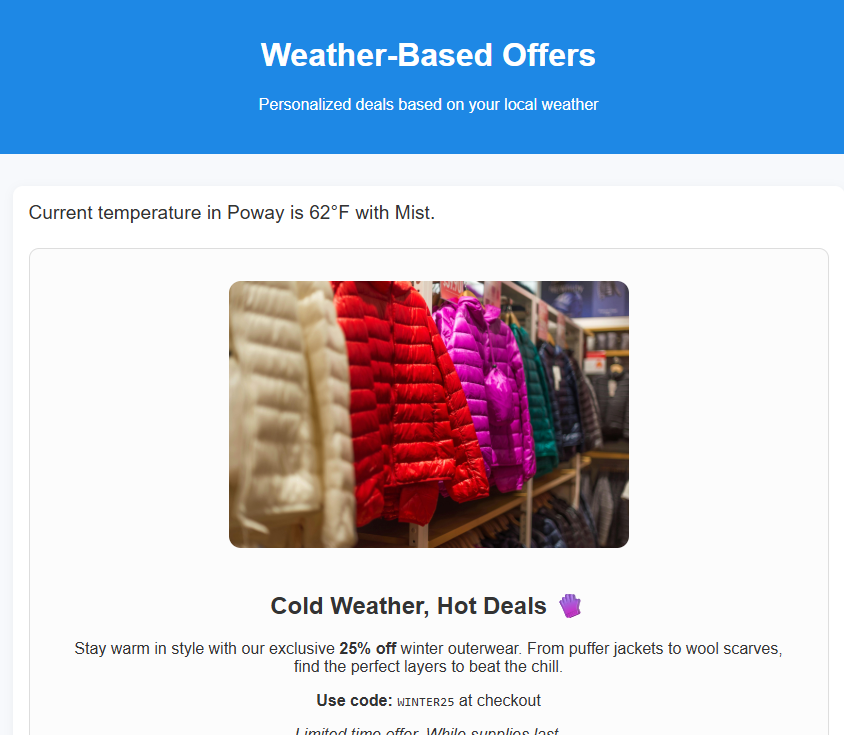

# Descripción del caso de uso

El uso de datos relacionados con el tiempo en Adobe Journey Optimizer (AJO) para ofrecer ofertas permite a las empresas personalizar las experiencias de los clientes en función de las condiciones ambientales en tiempo real. El tiempo es una poderosa señal contextual. Las necesidades y el comportamiento de la gente cambian dependiendo del clima. Mediante los datos meteorológicos:

Ofrezca ofertas relevantes que se alineen con el estado de ánimo y el entorno del cliente

En un día caluroso, mostrar una oferta de bebidas frías o unidades de aire acondicionado. En un día lluvioso, promociona chaquetas o paraguas

Ejemplo de una oferta basada en el tiempo

## Requisitos previos para este tutorial

* Acceso a Experience Platform.

* Comprensión básica de las etiquetas de Adobe Experience Platform.

* Comprensión básica de los conceptos de Experience Platform (perfiles, audiencias, conjuntos de datos).

* Familiaridad con Journey Optimizer.

* Conocimientos básicos de JavaScript (leer y escribir funciones simples).

* Capacidad para utilizar las herramientas de desarrollo del explorador (pestañas Consola y Red).
