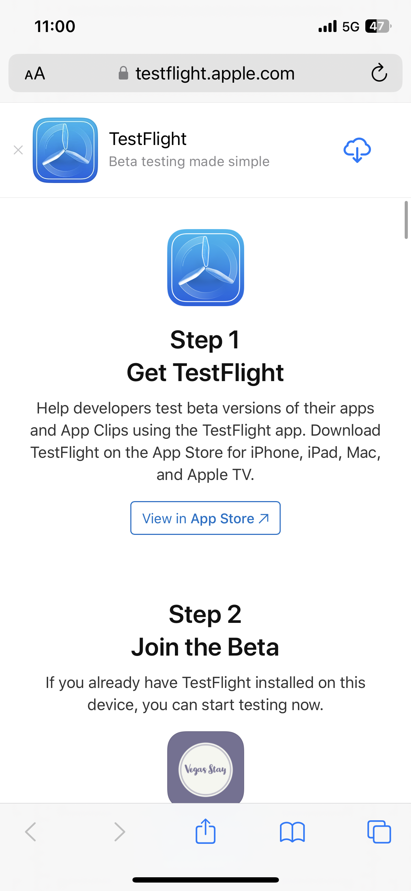
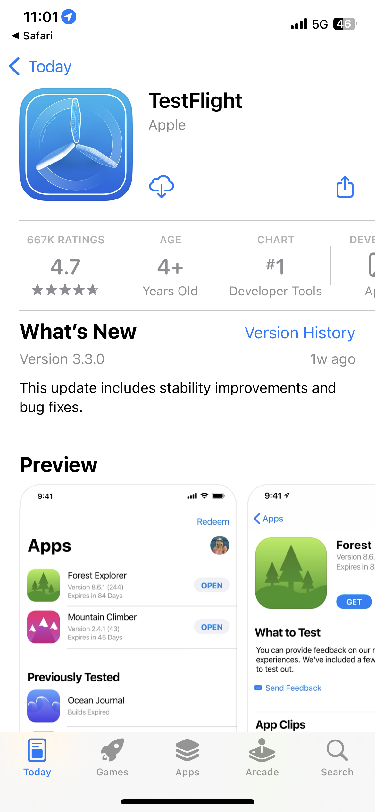
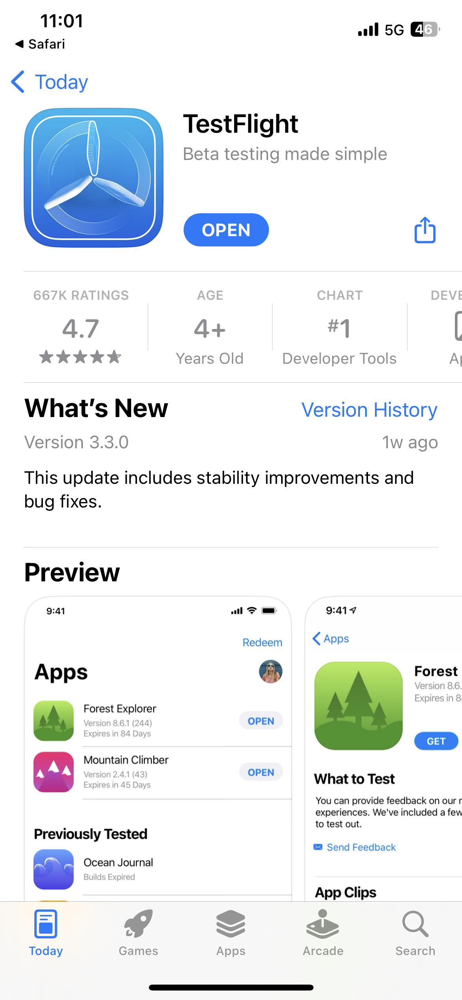
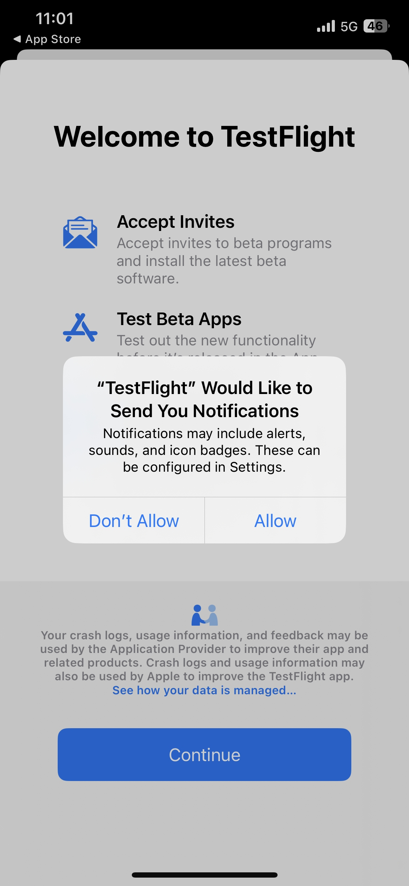
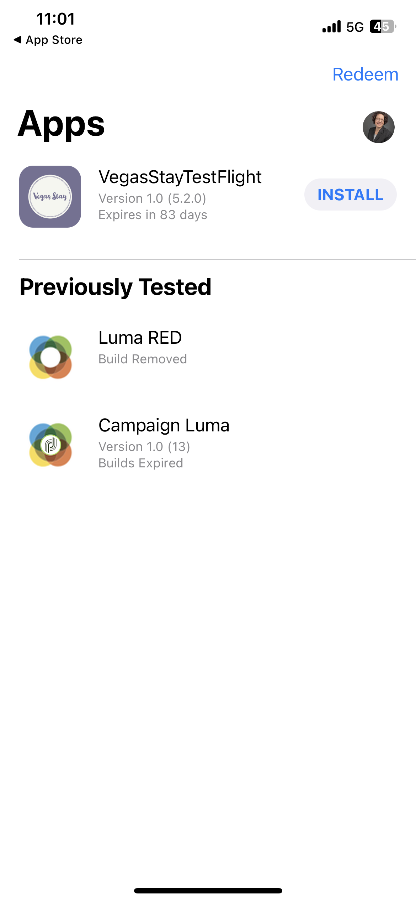
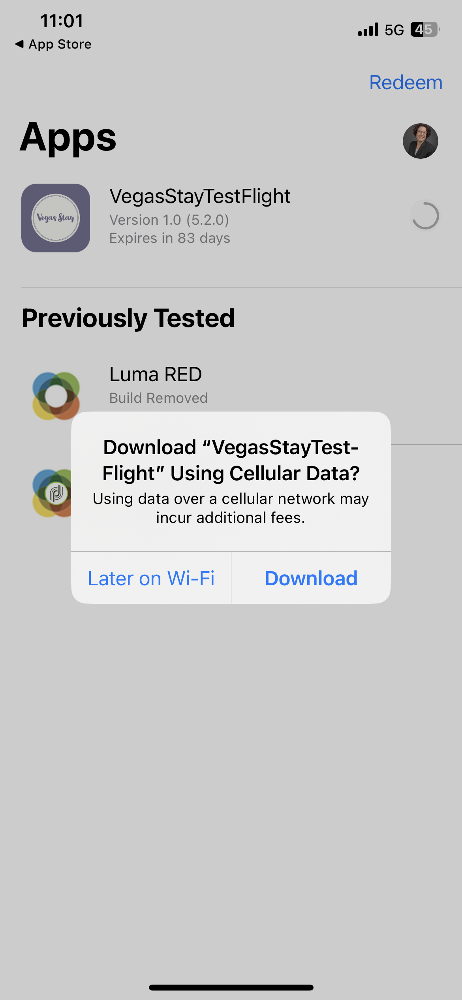
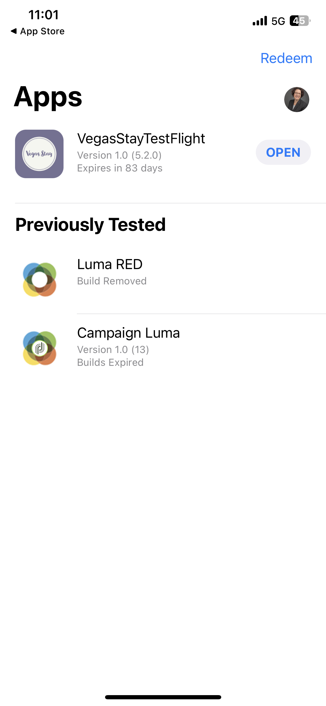
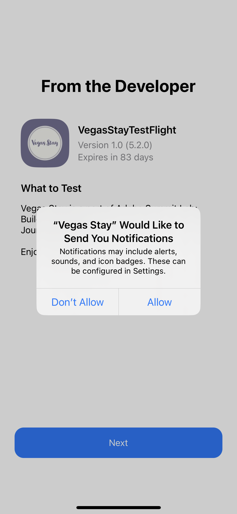

# Summit Lab L731 - Hoja de referencia

Esta página tiene texto y enlaces que están siendo utilizados en L731 Summit Lab. Permite copiar y pegar el contenido en los mensajes de Journey Optimizer.

## Lección 1.1: Descargar e instalar la aplicación

Analizar el código QR para descargar la aplicación

>[!BEGINTABS]

>[!TAB iOS]

>[!IMPORTANT]
>
>Si se le pide el código de canje, cierre la aplicación TestFlight y escanee el código QR una vez más.
>
>Permita notificaciones.
>

Se le pedirá que instale Testflight, pasos del 1 al 4. Una vez que haya instalado Testflight, siga los pasos 5 al 8 para instalar la aplicación Vegas Stay:

<table>
<tr>
</tr>
<tr>
<td>
 

      

      <b>Paso 1 </b>
      

      
      

  </td>
  <td>
 

      

      <b>Paso 2 </b>
      

      
      

  </td>
  <td>
 

      

      <b>Paso 3 </b>
      

      
      

  </td>
  <td>
 

      

      <b>Paso 4 </b>
      

      
      

  </td>
  </tr>
  <tr>
<td>
 

      

      <b>Paso 5 </b>
      

      
      

  </td>
  <td>
 

      

      <a>
      <b>Paso 6 </b>
      

        
      </a>
      

  </td>
  <td>
 

      

      <a>
      <b>Paso 7 </b>
      

        
      </a>
      

  </td>
  <td>
 

      

      <a>
      <b>Paso 8 </b>
      

        
      </a>
      

  </td>
  </tr>
</table>

>[!TAB Android]

Como la aplicación no está registrada en la tienda Google Play, recibirá un mensaje de advertencia:

Haga clic en **Instalar de todas formas**

>[!ENDTABS]

## Ejercicio 1: Iniciar sesión en Adobe Journey Optimizer

[Haga clic aquí para iniciar sesión en Journey Optimizer](https://experience.adobe.com/#/@techmarketingdemos/sname:summit-2023-ajo-lab/journey-optimizer/home){target="_blank"}

**Detalles de inicio de sesión**

* **Nombre de usuario:** `L731+<your seat number>@summitlab.us` (ejemplo: L731+001@summitlab.us)
* **Contraseña:** Adobe2023!

## Ejercicio 2: Creación de una campaña en la aplicación

| Sección | Campo | Texto | Vínculos |
|----|----|----|----|
| **Propiedades** | Nombre de la campaña | `<your seat number> Vegas Stay Campaign` |  |
| **Activadores** | Estado | reserva ahora |  |
| **Editar contenido:** medios | Opción URL de medios |  | https://i.ibb.co/NstLhjW/Firefly-Poster-with-heading-Adobe-Max-84773.jpg |
| **Editar contenido:** contenido | Título | Obtenga su descuento por anticipado. |  |
| **Editar contenido:** contenido | Cuerpo | Adobe Max vuelve a Las Vegas. Prepárese para ponentes motivadores, sesiones de perfeccionamiento de habilidades y nuevas conexiones. Reserve su suite ahora y obtenga un 10 % de descuento. |  |
| **Editar contenido:** botones | Botón | Consiga su 10 % de descuento. | lab://booking?suite=presidential&amp;discount=10 |
| **Editar contenido:** botones | Evento Interactivo | CTA en la aplicación |  |
| **Vista previa en el dispositivo** | URL base que se utilizará en la vista previa en el dispositivo |  | **iOS:** lab://  **Android**: https://lab |

## Ejercicio 3: Creación de una notificación push

| Campo | Texto | Vínculos |
|----|----|----|
| Nombre de la campaña | **`<your seat number> Max Push Campaign`** |  |
| Título | ¡Eh! |  |
| Cuerpo | ¿Sabía que Adobe Max va a volver a Las Vegas? Reserve su habitación ahora y obtenga un 10 % de descuento. |  |
| Opción URL de medios |  | https://i.ibb.co/1M0BnZn/Firefly-Big-conference-big-stage-with-ADBE-text-on-screen-40178.jpg |
