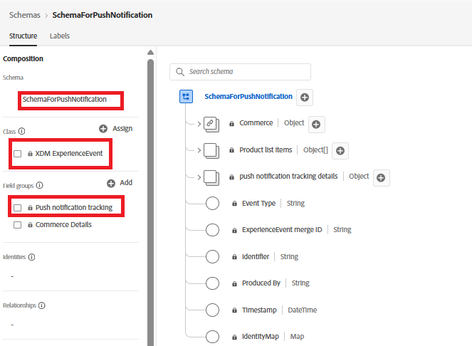
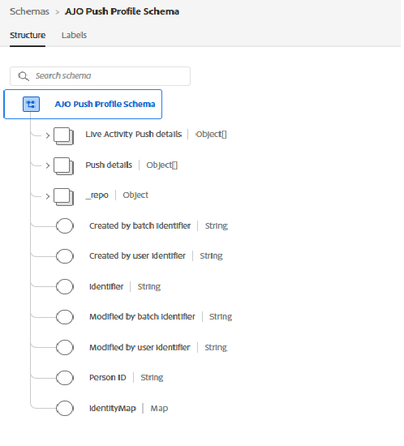
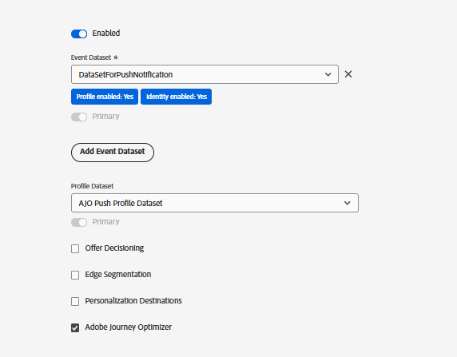

# Crear flujo de datos

Un conjunto de datos en Adobe Experience Platform (AEP) actúa como el extremo que recibe los datos enviados desde Web SDK. Enruta estos datos a servicios configurados como AEP, Adobe Analytics o Adobe Journey Optimizer. En este tutorial, la secuencia de datos se utiliza para enviar datos de suscripción push web y eventos price.drop a AEP para su activación.

## Crear esquema de eventos para rastrear notificaciones push

Cree un nuevo esquema XDM ExperienceEvent denominado `SchemaForPushNotification`. Agregar los grupos de campos `Push Notification Tracking` y `Commerce Details` a este esquema. Los campos del grupo de campos Detalles de Commerce se utilizarán para recopilar información del producto y almacenar en déclencheur el evento personalizado price.drop.

## Crear esquema de perfil para guardar el consentimiento del usuario

Para este tutorial, utilizamos el `AJO Push Profile Schema` listo para usar. Este esquema almacena los detalles de la suscripción push del usuario, incluido el token push necesario para enviar notificaciones push web.

## Crear conjuntos de datos para el esquema

Cree un conjunto de datos con el nombre `DataSetForPushNotification` mediante el esquema de eventos creado anteriormente. Para los datos de perfil, use el `AJO Push Profile Dataset` predeterminado, que está asociado con el esquema del perfil push. Anote el ID de `DataSetForPushNotification`, ya que será necesario más adelante en el tutorial al configurar la aplicación mediante el archivo .env.

## Creación de una secuencia de datos con el conjunto de datos de evento y perfil

Cree una nueva secuencia de datos denominada WebPushDataStream con los conjuntos de datos de evento y perfil creados en el paso anterior. Anote el ID de la secuencia de datos, ya que será necesario más adelante en el tutorial al configurar la aplicación mediante el archivo .env.

