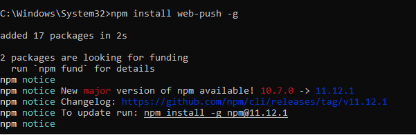
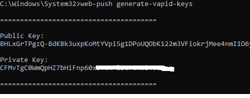
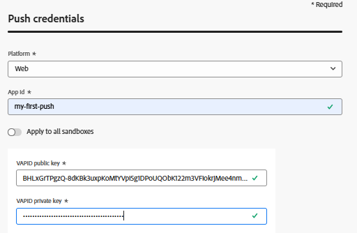
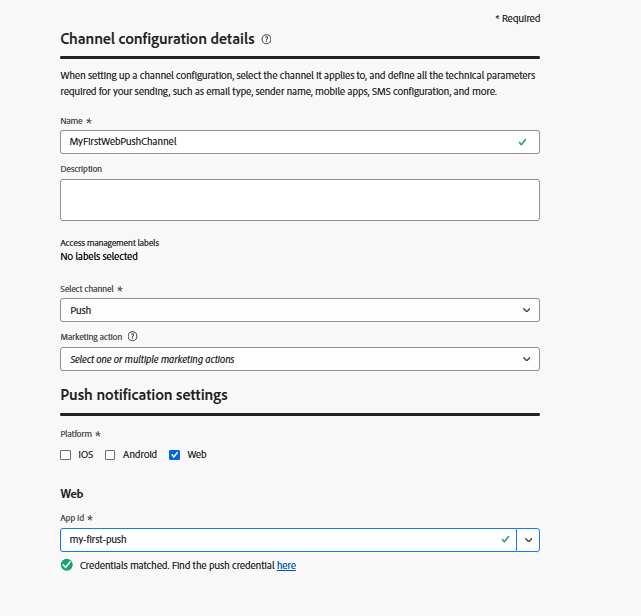

# Crear canal push

El primer paso es crear un canal push en Adobe Journey Optimizer. Como parte de esta configuración, deberá generar las claves VAPID, que son necesarias para autenticar y habilitar las notificaciones push web. Estas claves se utilizan en la configuración del canal push, lo que permite a AJO enviar notificaciones de forma segura a los usuarios suscritos.

## Generar claves VAPID

VAPID (identificación voluntaria del servidor de aplicaciones) es un estándar de inserción web que permite que el servidor se identifique ante los servicios push (como Chrome, Edge, etc.) uso de pares de claves públicas/privadas para que el proveedor push sepa quién envía la notificación.

Se genera mediante una herramienta como web-push generate-vapid-keys, que crea una clave pública (compartida con el explorador) y una clave privada (conservada en el servidor) que se utilizan juntas para autenticar y enviar mensajes push de forma segura.

Para este tutorial hemos utilizado Node.js para generar las claves VAPID.

Asegúrese de que tiene instalado Node.js. A continuación, ejecute el siguiente comando

`npm install web-push -g `

`web-push generate-vapid-keys`

## Crear credencial push

* Inicie sesión en Journey Optimizer

* Navegar a Administración | Canales | CONFIGURACIÓN DE PUSH | Credenciales push| Crear credencial push

* 

## Crear configuración de canal

* Inicie sesión en Journey Optimizer

* Navegar a Administración | Canales | Crear configuración de canal
  
