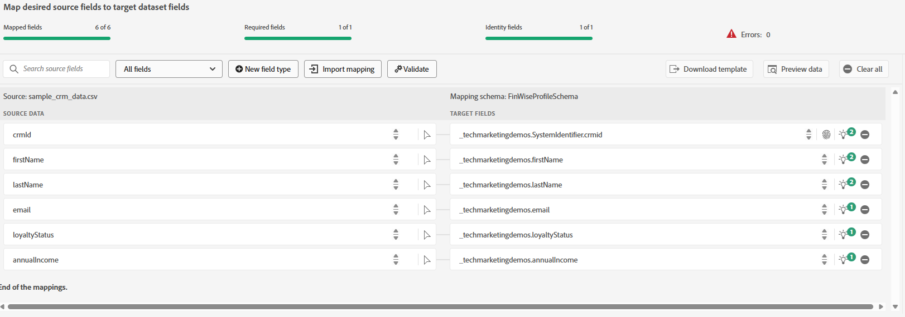
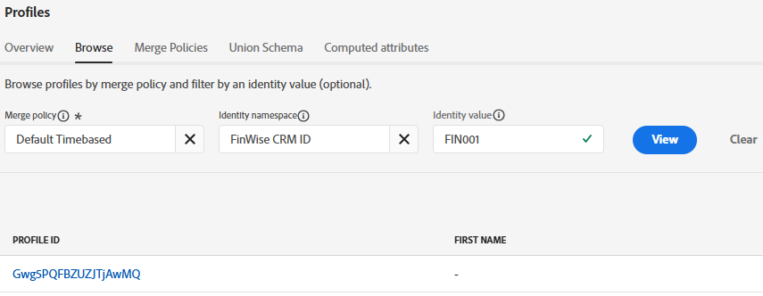

# Importar datos CRM de muestra en el conjunto de datos de perfil de AEP

Para comenzar la vinculación de identidad, importe datos de perfil de CRM de muestra a un conjunto de datos vinculado a un esquema habilitado para perfiles en Adobe Experience Platform

## Crear un área de nombres personalizada

* Vaya a Cliente -> Identidades -> Crear área de nombres de identidad
* Seleccione ID individual entre dispositivos y proporcione el nombre para mostrar y el símbolo de identidad como se muestra en la captura de pantalla siguiente.
  

## Creación de un esquema habilitado para el perfil

Cree un esquema de perfil individual denominado **_FinWiseProfileSchema_**. Incluya campos como annualIncome, email, firstName, lastName y loyaltyStatus.
Agregue un campo de identidad **_crmid_** como se muestra. Marque el campo crmid como identidad y principal.

## Preparar datos de ejemplo

Actualice las direcciones de correo electrónico ficticias a direcciones reales. Se utilizarán más adelante al enviar mensajes con Adobe Journey Optimizer.

|   | crmId | firstName | lastName | correo electrónico | loyaltyStatus | zipCode | annualIncome |
|---|--------|-----------|----------|-------------------------|---------------|---------|--------------|
|   | FIN001 | Alice | Wong | alice.wong@example.com | Oro | 92128 | 120000 |
|   | FIN002 | Bob | Smith | bob.smith@example.com | Plata | 92126 | 85000 |
|   | FIN003 | Charlie | Kim | charlie.kim@example.com | Platino | 60614 | 175000 |
|   | FIN004 | Diana | Lee | diana.lee@example.com | Oro | 30303 | 98000 |
|   | FIN005 | Ethan | Marrón | ethan.brown@example.com | Bronce | 75201 | 60000 |

## Ingesta del archivo CSV

* Cree un conjunto de datos llamado **_FinWiseCustomerDataSetWithAnnualIncome_** basado en el **_FinWiseProfileSchema_** creado en el informe anterior. Asegúrese de que el conjunto de datos esté habilitado para el perfil.

* Vaya a Conexiones -> Fuentes -> Sistema local
* Seleccione **_Agregar datos_** en la carga de archivo local. Asegúrese de seleccionar _&#x200B;**FinWiseCustomerDataSetWithAnnualIncome**&#x200B;_ como conjunto de datos de destino.
  
* Vaya a la pantalla siguiente. Cargue el [archivo csv](assets/finwise_profiles.csv) y verifique las asignaciones
  

* Haga clic en Finish para iniciar el proceso de ingesta de datos

## Verificar perfil

* Vaya a Cliente ->Perfiles y busque ID de FinWise CRM igual a FIN001 o cualquier otro valor válido
  
