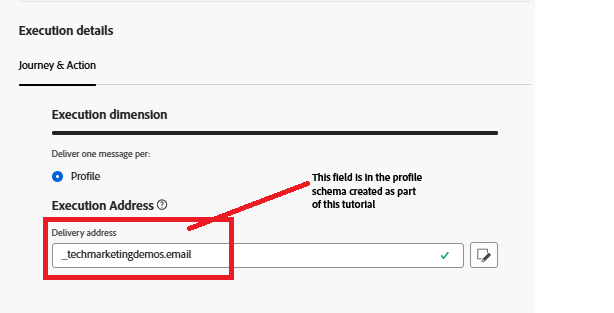
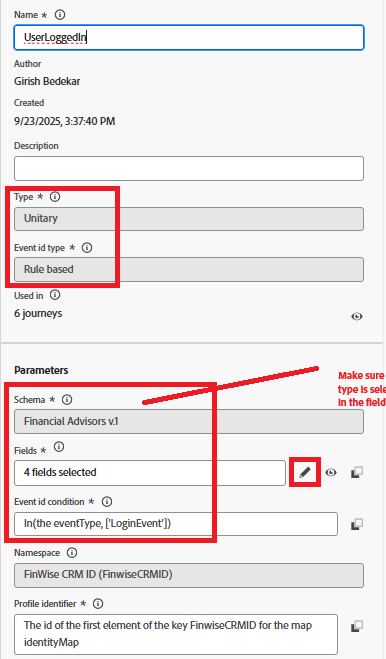
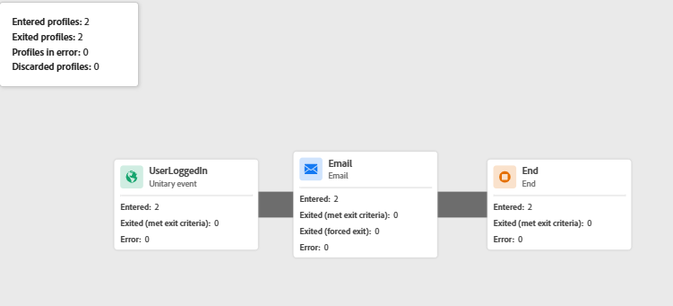

# Déclencheur del Recorrido de Adobe Journey Optimizer mediante Adobe Web SDK

En esta extensión del tutorial de vinculación de identidad, se activa el recorrido de Adobe Journey Optimizer que envía un correo electrónico al usuario que ha iniciado sesión utilizando su perfil vinculado. **Este artículo supone que está familiarizado con el canal de correo electrónico y la creación de contenido para el canal de correo electrónico.**

## Crear configuración de canal de correo electrónico

* Iniciar sesión en _&#x200B;**Journey Optimizer**&#x200B;_
* Vaya a _&#x200B;**Administración -> Canales -> Crear configuración de canal**&#x200B;_
* Seleccione **Correo electrónico** de la lista de canales. Proporcione un nombre y una descripción significativos.
* Rellene la configuración de correo electrónico.
* Proporcione los detalles de ejecución como se muestra a continuación. El correo electrónico se envía a la dirección de correo electrónico del perfil almacenada en el campo
* 
* Activar la configuración del canal de correo electrónico

## Crear evento

* Iniciar sesión en _&#x200B;**Journey Optimizer**&#x200B;_
* Vaya a _&#x200B;**Administración -> Configuraciones**&#x200B;_
* Haga clic en el botón Administrar de la tarjeta Eventos y haga clic en Crear evento. Especifique los valores como se muestra a continuación
* 

* Compruebe si eventType del evento es igual a LoginEvent. El tipo `LoginEvent` se ha definido en la etiqueta Adobe Experience Platform.
* Guarde el evento

## Crear Recorrido

* Iniciar sesión en _&#x200B;**Journey Optimizer**&#x200B;_
* Vaya a _&#x200B;**Administración de Recorrido -> Recorridos -> Crear Recorrido**&#x200B;_
* Arrastre y suelte el evento _&#x200B;**UserLoggedIn**&#x200B;_ en el lienzo
* Arrastre y suelte Correo electrónico desde el menú de acciones. Configure la acción de correo electrónico para utilizar la configuración de canal de correo electrónico creada anteriormente.
* Publique el recorrido.

## Cómo se activa el recorrido

El recorrido se activa cuando la carga útil de evento enviada a través de Web SDK coincide con la configurada en la recorrido. En este ejemplo, el evento es `UserLoggedIn` y el tipo de evento es `LoginEvent`.

* Verifíquelo consultando el informe de recorrido
* 
