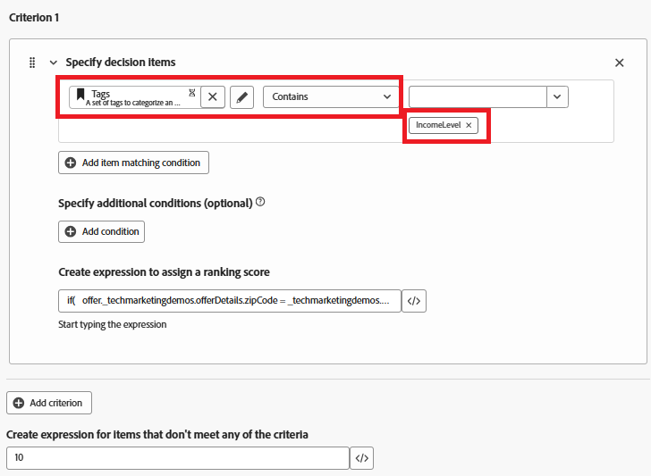

# Crear fórmula de clasificación

Durante la toma de decisiones de oferta se utiliza una fórmula de clasificación en Adobe Journey Optimizer, específicamente dentro de una estrategia de selección para determinar el orden de prioridad de las ofertas aptas. La fórmula de clasificación entra en juego después del filtrado de elegibilidad, cuando varias ofertas cumplen los requisitos para un perfil determinado, pero solo la principal (o pocas) debe presentarse en función de la lógica empresarial o el contexto del perfil.

* Iniciar sesión en Journey Optimizer

* Decisioning ->Configuración de estrategia ->Fórmulas de clasificación ->Crear fórmula

Fórmula de clasificación


Un criterio en una fórmula de clasificación hace referencia a una regla condicional utilizada para asignar una puntuación a una oferta. Estos criterios comparan atributos de la oferta y el perfil o contexto para determinar la relevancia de una oferta para un individuo específico.


Criterios 1

Esta condición filtra los elementos de decisión (ofertas) **para incluir solamente** las ofertas etiquetadas con &quot;IncomeLevel&quot;.
Estas ofertas filtradas pasan al siguiente paso, como la clasificación o la entrega, en función de la lógica adicional que defina.



La siguiente expresión se utiliza para crear la puntuación de clasificación

```pql
if(   offer._techmarketingdemos.offerDetails.zipCode = _techmarketingdemos.zipCode,   _techmarketingdemos.annualIncome / 1000 + 10000,   if(     not offer._techmarketingdemos.offerDetails.zipCode,     _techmarketingdemos.annualIncome / 1000,     -9999   ) )
```

Qué hace la fórmula

* Si la oferta tiene el mismo código postal que el usuario, asígnele una puntuación muy alta para que se seleccione primero.

* Si la oferta no tiene código postal (se trata de una oferta general), asígnele una puntuación normal basada en los ingresos del usuario.

* Si la oferta tiene un código postal diferente al del usuario, asígnele una puntuación muy baja para que no esté seleccionada.

De este modo, el sistema:

* Siempre intenta mostrar primero una oferta que coincida con el ZIP,

* Vuelve a una oferta general si no se encuentra ninguna coincidencia y evita mostrar ofertas destinadas a otros códigos postales.


Si un elemento de oferta no cumple ninguno de los criterios de filtro (como no tener la etiqueta &quot;IncomeLevel&quot;), la oferta recibe una puntuación de clasificación predeterminada de 10.


