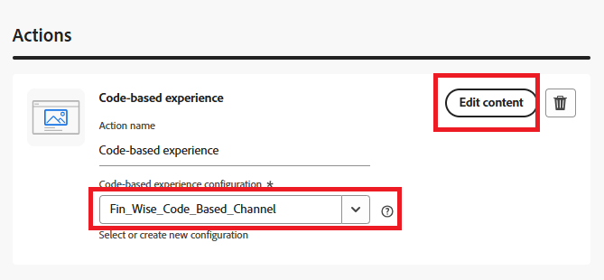
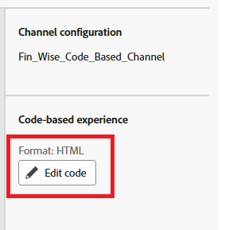

# Creación de una campaña

En Adobe Journey Optimizer (AJO), una campaña sirve como contenedor que reúne todos los elementos necesarios para ofrecer experiencias personalizadas a una audiencia segmentada. Organiza cuándo y cómo se presentan las ofertas y vincula componentes como canales, ubicaciones, colecciones y estrategias de decisión.

1. Inicie sesión en Journey Optimizer.
1. Haga clic en **[!UICONTROL Administración de Recorrido]** > **[!UICONTROL Campañas]** > **[!UICONTROL Crear campaña]** > **[!UICONTROL Programar marketing]**.
1. Proporcione un nombre significativo a la campaña
1. Vaya a la ficha _**Acción**_
1. Seleccione la acción **[!UICONTROL Experiencia basada en código]** y, a continuación, seleccione la configuración creada en el paso anterior.
1. Haga clic en **[!UICONTROL Editar contenido]**.

   

1. Para abrir el editor de personalización, haga clic en **[!UICONTROL Editar código]**.

   

   El editor de personalización es una interfaz de creación de experiencias no visual que le permite crear código.
